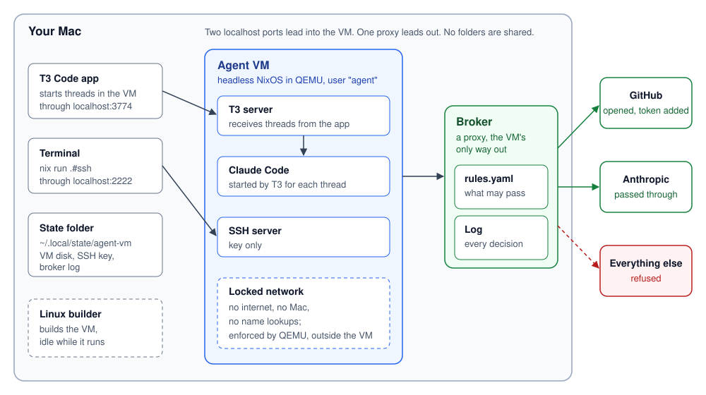

# nixos-agent-sandboxing

A headless NixOS VM for running coding agents from T3 Code on a Mac.

An agent can be tricked by what it reads, or make a mistake. Here it works in
a machine of its own that shares nothing with the Mac. The plan is for a
broker on the Mac to hold the keys and attach them to outgoing requests, so
the VM never holds one. Only the VM exists so far.



## Quick start

With the Linux builder on (see [setup](docs/setup.md)):

```sh
nix run .#vm     # start the VM; Ctrl-A then X stops it
nix run .#ssh    # open a shell in the VM as the `agent` user
```

Then sign in to Claude inside the VM and link it to the T3 app. The steps
are in [docs/setup.md](docs/setup.md).

## Documentation

| Page | Contents |
| --- | --- |
| [docs/setup.md](docs/setup.md) | Getting it running, day-to-day commands, problems |
| [docs/architecture.md](docs/architecture.md) | The parts, what crosses between Mac and VM, the target design |
| [PLAN.md](PLAN.md) | The phases and the risks |
| [CLAUDE.md](CLAUDE.md) | Instructions for agents working on this repo |
