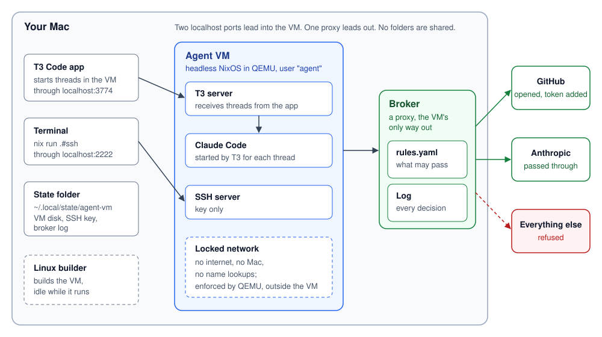
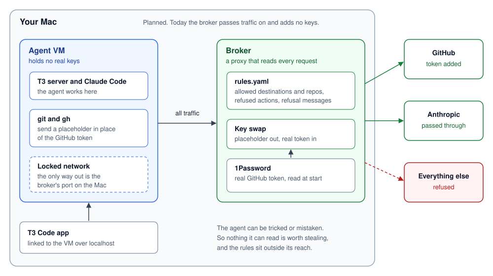

# Architecture

A coding agent can be tricked by what it reads, or simply make a mistake. This
project gives it a machine of its own, so that a mistake stays inside that
machine and there is nothing in it worth stealing.

The work is done in phases, listed in [PLAN.md](../PLAN.md). This page
describes what runs today first, and the target design after it.

## What runs today

| Part | Where | What it does |
| --- | --- | --- |
| T3 Code app | Mac | Where you start and follow threads. It is linked to the VM as a second environment. |
| Agent VM | Mac, in QEMU | A headless NixOS system, defined in [`vm/default.nix`](../vm/default.nix). |
| T3 server | VM | Receives threads from the app and starts Claude Code for each one. A system service, started at boot. |
| Claude Code | VM | The agent. It runs as the `agent` user, which has no `sudo`. |
| SSH server | VM | A shell for you, for signing in to Claude and for debugging. |
| State folder | Mac | `~/.local/state/agent-vm` holds the VM's disk and the SSH key that reaches it. While the VM runs it also holds QEMU's control socket, which the stop command uses. |
| Linux builder | Mac | A small NixOS VM that builds Linux packages. It is needed to build the agent VM, and plays no part while the agent VM runs. |

### What crosses the line between the Mac and the VM

- **Into the VM:** two ports, both listening on the Mac's localhost only.
  Port 2222 leads to SSH and port 3774 leads to the T3 server.
- **Out of the VM:** ordinary internet access through QEMU. This is open for
  now and is locked down in phase 3.
- **Not shared:** folders, the Mac's Nix store, and keys. The VM has its own
  copy of the Nix store and its own disk.

The only credential in the VM today is the Claude sign-in you do inside it.

### How the VM gets its SSH key

No key is kept in this repo. The start command generates a key pair in the
state folder on first use and passes the public half to the VM on its kernel
command line. A service in the VM reads it at boot and tells the SSH server to
accept it. A public key is safe to pass this way; the private half never
leaves the Mac.

### How the VM is built and changed

1. `nix run .#vm` asks Nix for the VM described in this repo.
2. Nix hands the Linux parts to the Linux builder and gets back a system
   image and a start script.
3. The start script creates the disk on first use and runs QEMU.

The system (programs, services, settings) comes from the repo on every start,
so a change to `vm/default.nix` takes effect after a restart. The disk is kept
between starts, and with it `/home/agent`: cloned repos, the Claude sign-in
and T3's data.

## The target design

Two things change from today:

- **The network is locked.** The VM can reach one address: the broker on the
  Mac. A program in the VM that tries any other destination gets no answer.
- **The broker holds the keys.** It is a proxy that reads each request,
  checks it against `rules.yaml`, and swaps a placeholder for the real token
  on the way out. The real token stays in the macOS Keychain.

The rules live on the Mac, outside the VM, so the agent cannot change them.
GitHub is the first service. Others can be added later as new rules.

## Where things are

| Path | Contents |
| --- | --- |
| [`flake.nix`](../flake.nix) | The entry point: the VM, the two commands, and the Mac module |
| [`vm/default.nix`](../vm/default.nix) | The VM's system: services, tools, ports |
| [`vm/t3.nix`](../vm/t3.nix) | The T3 server, pinned to a version |
| [`vm/host-scripts.nix`](../vm/host-scripts.nix) | The commands behind `nix run .#vm`, `.#stop`, `.#ssh` and `.#pair` |
| [`darwin/default.nix`](../darwin/default.nix) | What the Mac itself needs, as a nix-darwin module |
| `broker/` | Planned: the proxy and its rules |
| `tests/` | Planned: checks run inside the VM |
