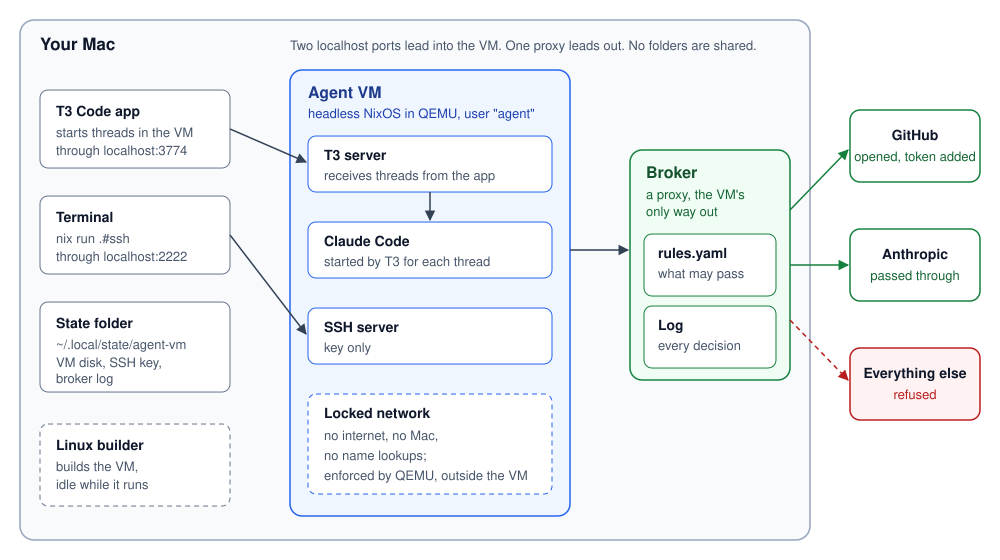

# Threat model

This page is for someone deciding whether to trust nixt3 with their accounts.
It says what is protected, who the attacker is, what stops them, and what
does not stop them. The last part has the same weight as the rest. Read it
before you rely on this.

It describes the code after phase 5: the VM, the network lock, GitHub
through the broker with the token kept on the Mac, and the rules for which
requests to GitHub the broker lets out. The plan is in [PLAN.md](../PLAN.md).

One thing is not finished: the check with a real GitHub token has not been
run. See [What has not been run](#what-has-not-been-run).

## Words used on this page

| Word | Meaning here |
| --- | --- |
| Broker | The proxy on the Mac that is the VM's only way out. It is [`broker/proxy.py`](../broker/proxy.py), a script for the program mitmproxy. |
| TLS | The encryption that HTTPS uses. The first message of a TLS connection names the site in clear text; everything after it is encrypted. |
| Tunnel | What a program asks a proxy for when it wants HTTPS: "connect me to this host and pass on what I send". The proxy sees the host and the port, and then encrypted data. |
| Passed on unread | The broker lets the encrypted data of a tunnel through without opening it. This is what it does for Anthropic. |
| Opened | The broker ends the encryption itself, reads each request, and sends it on over a new encrypted connection. This is what it does for GitHub. |
| Certificate authority | A key that signs certificates. A program trusts a site when its certificate is signed by an authority the program trusts. The broker has one of its own, so that it can answer the VM in GitHub's name. |
| Placeholder | The fixed text `nixt3-placeholder-not-a-real-token`. Programs in the VM log in to GitHub with it. It is public and gives no access. |
| Fails closed | When something goes wrong, the answer is "no". A broker that fails closed refuses or does not start; it never lets everything through. |
| Domain fronting | Naming an allowed site at the start of an encrypted connection and asking for another site inside it, where a proxy cannot see. It works when both sites are served by the same company's machines. |

## The short version

- **Holds today:** a program in the VM cannot reach the Mac's files, the
  Mac's own services, your home network, or any host that is not on a list
  of five. It can use GitHub with your token without being able to read the
  token, and only for the repos the rules list: a request about another
  repo, or one that changes a repo's settings, secrets or access, does not
  leave the Mac. `nix run .#check` and `tests/github-broker.sh` test most
  of this.
- **Does not hold:** the listed hosts are still a way to send data out. In a
  repo the rules list for writing, the agent can push and write whatever it
  likes; what is inside a push is not looked at. The Claude sign-in
  is inside the VM and can be used or copied. Any program on the Mac can use
  the token through the broker's port. The broker and QEMU are ordinary
  programs on the Mac that run with your rights, and a bug in either is a
  way onto the Mac.
- **Not built yet:** a confined broker (phase 6).

## What is protected

| Thing | Where it is | What must not happen |
| --- | --- | --- |
| The Mac's files | The Mac's disk | The agent reads, changes or deletes them |
| The Mac's programs and services | The Mac, many on `localhost` | The agent talks to them or starts them |
| Your home or office network | Around the Mac | The agent reaches other machines on it |
| The GitHub token | Your password manager, and the broker's memory while it runs | The agent reads it, or gets it sent to a place of its choice |
| Your other tokens and keys | Keychain, 1Password, `~/.ssh`, `gh`'s own token | The agent reads them |
| Your accounts | GitHub, Claude, others | The agent acts as you beyond the task |
| The rules | [`broker/rules.yaml`](../broker/rules.yaml), on the Mac | The agent changes what it is allowed to reach |
| The tokens file | `~/.config/nixt3/tokens.yaml`, on the Mac | Someone changes it. It names a program that is run as you each time the broker starts. |
| The key of the broker's certificate authority | `broker/mitmproxy-ca.pem` in the state folder, on the Mac | It leaves the Mac. Whoever holds it can pose as any site towards the VM. |

**The contents of the VM are not protected from the attacker.** Assume the
attacker knows everything in the VM and can change all of it. One thing in
the VM is still worth something to them: the Claude sign-in. That is a known
loss, not something this design prevents. See
[The Claude sign-in is in the VM](#the-claude-sign-in-is-in-the-vm).

## The attacker

There are two ways to become the attacker. Both end in the same place.

1. **An agent that was tricked.** A coding agent reads web pages, issues,
   code and package files. Any of them can hold text that tells the agent to
   do something else. The agent then uses its own tools against you.
2. **A hostile program.** The agent installs or runs code that is hostile: a
   package, a build script, a test. It runs as the `agent` user in the VM.

In both cases the attacker is taken to have **full control of the `agent`
user in the VM**: every file in `/home/agent`, every program in the VM, and
the Claude sign-in stored there. The design also assumes the attacker may
become `root` in the VM. The network lock does not depend on stopping that.

### Out of scope

- **Someone who is already on the Mac.** A program that runs as you on the
  Mac can read the VM's disk, the SSH key that opens the VM, the rules and
  the key of the broker's certificate authority. Everything here protects
  the Mac from the VM, not the VM from the Mac.
- **Someone with the Mac in their hands,** or another user account on it.
- **The services themselves.** A break-in at GitHub or Anthropic.
- **The supply chain of this project.** nixpkgs, QEMU, mitmproxy and the T3
  server are taken as they are. The T3 server is pinned by checksum in
  [`vm/t3.nix`](../vm/t3.nix); nixpkgs is pinned in `flake.lock`.
- **What the model provider sees.** What the agent reads is sent to
  Anthropic, with or without a sandbox.

## What the attacker can try, and what stops it

The last column of each table says what proves the claim:

| Proof | Meaning |
| --- | --- |
| A name in quotes | A check in [`tests/network-lock.sh`](../tests/network-lock.sh), run inside the VM by `nix run .#check` |
| Mac test | A check in [`tests/github-broker.sh`](../tests/github-broker.sh). It runs a broker of its own on the Mac against a stand-in for GitHub, so it can see what the broker lets out. |
| By hand | Looked at once by hand. No check repeats it. |
| Nothing | The claim rests on reading the code |

All three were done on 2026-11-17. The rows about the lock and the token
were done on `main` at commit `a0ad1a0`, and "by hand" on the running VM,
which was the build of that commit. The tests were run again on the commit
that put the GitHub rules to use: `nix run .#check` passed every check,
`tests/github-broker.sh` has 249 checks, and the 2356 unit tests in
`tests/unit/` passed. One of the 249, "a first TLS message that never ends:
logged", sometimes fails when the Mac is busy; it waits three seconds for a
line in the log. The token on the Mac was a made-up one that day.

### Going around the broker

All of this is stopped in one place: QEMU's restricted network. The VM's
network card is not connected to the Mac's network. QEMU itself plays the
network, and with `restrict=on` it drops everything the VM sends except to
forwards that are listed. QEMU runs on the Mac, outside the VM, so no program
in the VM can turn this off, not even as `root`.

The setting is the `restrict=on` part of `qemu.networkingOptions` in
[`vm/default.nix`](../vm/default.nix). The whole network option is written
out there.

| The attacker tries | Proof |
| --- | --- |
| Connect straight to a site, ignoring the proxy settings | "a direct connection by name is blocked", "a direct connection by address is blocked" |
| The same over IPv6 | "a direct connection over IPv6 is blocked" |
| Look up names, or hide data in name lookups | "names cannot be looked up", "QEMU's own name server does not answer", "QEMU's own name server refuses connections", "a public name server is out of reach" |
| Reach the Mac itself, which the VM sees as `10.0.2.2` | "the Mac itself is out of reach" |
| Reach other machines on your network | Nothing. No check uses a home-network address. It is the same mechanism as the rows above. |
| Use SSH, or any protocol that is not HTTP | "SSH to GitHub is blocked" |
| Become `root` in the VM and remove the lock | Nothing. No check runs as `root`. |

### Going through the broker

One forward leads out of the VM. Connections to `10.0.2.100:3128`, an address
that exists only inside the VM, are handed to the broker on the Mac's
`localhost:8474`. It is the `guestfwd` part of the same network option.

| The attacker tries | What stops it | Proof |
| --- | --- | --- |
| Ask for a host that is not listed | `Broker.refusal` looks the host up in the rules and answers 403 | "a destination that is not listed is refused" |
| Ask for it over plain HTTP | The same check, in `requestheaders` | "plain HTTP is refused" |
| Ask for a listed host on another port | A host is allowed on port 443 only, unless its rule lists more | "an allowed host on another port is refused" |
| Open a tunnel to a listed host, then name another site at the start of the encryption | `tls_clienthello` compares that name with the tunnel's host | "a tunnel cannot be used for a different site"; on the Mac "the broker logged the wrong site name as refused" |
| Hide the real site name (Encrypted Client Hello) | `tls_clienthello` refuses a first message that carries a hidden name | Nothing |
| Start a tunnel inside a tunnel, or encryption inside an opened connection | `http_connect` and `tls_clienthello` refuse both | Nothing |
| Send something in a tunnel that is neither TLS nor HTTP | `rawtcp=false` in [`darwin/commands.nix`](../darwin/commands.nix) makes mitmproxy drop it | Nothing |
| Send plain HTTP inside a tunnel | `requestheaders` refuses it, for every destination | "clear text inside a tunnel to github.com is refused", and the same for `api.anthropic.com` |
| Name a listed host in the `Host` header and send to another | The broker checks where the request will really go, not the header | "plain HTTP to an unlisted host is refused, also when it names a listed one" |
| Use the broker to reach the Mac's `localhost` | Only listed names pass | "a tunnel to the Mac's own address is refused", "a tunnel to the Mac by the name localhost is refused" |
| Get `localhost` or an address onto the list | `load_rules` refuses a rule that is an address or a name without a dot | Nothing |
| Find any other path through mitmproxy | `server_connect` is a last gate. It runs before every connection the broker opens and refuses an unlisted one. | Nothing |
| Make the broker's own code fail, so that it lets a request through | Every point where mitmproxy calls the broker is wrapped (`fail_closed`). An error ends in a refusal. | Mac test: "When the broker's own code fails", for eight such points |

### Getting at the GitHub token

The token is not in the VM. Programs there log in with the placeholder, and
the broker puts the real token in its place on the way out. This is in
[`broker/swap.py`](../broker/swap.py) and `opened_request` in `proxy.py`.

| The attacker tries | What stops it | Proof |
| --- | --- | --- |
| Find the token in the VM | It was never put there | "gh's token in the VM is the placeholder", "git's password for GitHub in the VM is the placeholder", "no file in the VM holds something that looks like a GitHub token", and the same for programs' environments |
| Have the token sent to a site other than GitHub | A token is added only when the tunnel, the name at the start of the encryption and every name in the request are the GitHub host from the rules | "a request that names another site than its connection is refused"; Mac test: "a tunnel cannot be used under another name" |
| Pose as GitHub towards the broker | `server_connect` sets the name the server must prove, and mitmproxy checks the server's certificate against it. A broker started with that check off adds no token. | Nothing. No test uses a server with a wrong certificate. |
| Have the token sent without encryption | An opened destination is never contacted in clear text | Mac test: "clear text inside a tunnel is refused", "clear text sent to the broker directly is refused" |
| Ask GitHub to send the request back, token included (`TRACE`) | Refused | Mac test: "TRACE, which would send the token back, is refused" |
| Read the token in the broker's log | Headers are not logged. Everything the broker process writes also passes a filter that replaces the token. | Mac test: "the token is in no log and no file of the broker", "a token in a line that mitmproxy wrote is replaced" |
| Use another login on GitHub: a token of the attacker's own, or one found on a web page | Refused, not removed. Cookies are left out of the request. | "a request with any other token is refused by the broker"; Mac test: "another token is refused and never leaves", "a cookie is left out" |
| Hide a second login in a header that runs over two lines | A header with a line break is refused | Mac test: "a login on a continuation line", "a login after a lone carriage return" |
| Claim another host or sender in a header such as `X-Forwarded-Host` | Such headers are left out | Mac test: "headers that claim another host or sender are left out" |
| Put a byte outside plain ASCII in a header, which the broker and GitHub might read differently | Refused | Mac test: "six headers with a byte outside plain ASCII are refused, and none arrives" |
| Put U+0000 or half a surrogate pair in a name of a JSON body, so that the name reads as another one after GitHub's reader has dropped it | Refused | Nothing through the broker; unit tests of `github_policy.py` |
| Claim another method in a header such as `X-HTTP-Method-Override` | Refused | Mac test: "a header that asks for another method than the one sent is refused" |
| Name headers in a `Connection` header, for GitHub's own servers to drop after the broker has judged the request | A `Connection` header may say `close` or `keep-alive` only | Mac test: "a Connection header that names other headers to drop" |
| Switch the connection to another protocol, or send lines after the body | Refused | Mac test: "a request to switch to another protocol is refused", "a request that announces trailers is refused before anything is sent" |

What these rows do **not** say: which requests may go out with the token.
That is [GitHub rules: in use](#github-rules-in-use), below.

### Filling the Mac's memory through the broker

| The attacker tries | What stops it | Proof |
| --- | --- | --- |
| Send a request whose first lines never end | [`broker/limits.py`](../broker/limits.py) closes a connection that has sent 128 KiB without making up a request | "a request that never ends is cut off by the broker"; Mac test: "More than the broker takes in" |
| Send a first TLS message that never ends | The same file allows 64 KiB | Mac test: "a first TLS message that never ends" |
| Send a body that never ends | A body is held in memory only when it is declared to be at most 1 MiB. A larger one is passed on in pieces, or cut off when the request is refused. | Mac test: "Large bodies" |
| Open very many connections | The broker holds at most 256 at once (`MAX_CLIENTS`) | Nothing |
| Run a mitmproxy that the limits do not fit | The broker does not start when mitmproxy's code differs from what `limits.py` was written for | Mac test: "the limits refuse to go into a mitmproxy they were not written for" |

This bounds the broker's memory. It does not bound how much the VM sends
*through* the broker to an allowed host.

### Changing the rules, or starting without them

| The attacker tries | What stops it | Proof |
| --- | --- | --- |
| Edit `rules.yaml` | It is on the Mac. Nothing on the Mac is shared with the VM. | "no folder is shared with the Mac" |
| Have the broker start with a rules file that is missing or wrong | `start` in `proxy.py` exits, and `nix run .#vm` then does not start the VM | Mac test, for the part about GitHub: "rules without a github part", "a mistake in the github part", "an opened host that is not GitHub". Nothing for the rest of the file, and nothing shows that the VM is then not started. |
| Have mitmproxy change a request after the broker judged it, through one of mitmproxy's own settings, a settings file in the broker's folder, or a setting changed while it runs | The broker does not start with a setting it does not know, or with such a file, and stops when a setting changes ([`broker/settings.py`](../broker/settings.py)). The folder is on the Mac, so this takes a program that already runs as you. | Mac test: "a settings file in the broker's folder", "a setting that sends a request elsewhere after it was judged (map_remote)", and ten more; "A setting that changes while the broker runs", eight checks |
| Have mitmproxy write the keys of its encrypted connections to a file, or load code or settings, through a variable in the shell the broker is started from (`SSLKEYLOGFILE`, `PYTHONPATH`, `OPENSSL_CONF`) | The start command gives mitmproxy an environment of its own, and the broker refuses to start with a variable it does not know. Some people set `SSLKEYLOGFILE` themselves, so this is not only about an attacker. | Mac test: "the keys of the broker's connections were written nowhere", "started by hand with SSLKEYLOGFILE set", and eight more |
| Have the broker start without its token | `fetch_tokens.py` and `receive_tokens` stop the start | Mac test: "Starting without what it needs" |
| Slip a rule in through a typing mistake | `load_rules` rejects unknown keys, wildcards, addresses and a missing `note` | Nothing |
| Write false lines into the broker's log | `_clean` turns spaces and unprintable characters into `_` and `?`, and cuts a field at 255 characters | Nothing |

The rules the background broker uses are the repo's copy, fixed when the
command was built. A rules file named in the shell applies to
`nix run .#broker` only.

**Who holds the broker's port.** When `nix run .#vm` finds that something
already listens on `localhost:8474`, it goes on only if the file
`broker-foreground.pid` in the state folder names a live process whose
command line contains `mitmdump` or `agent-vm-broker-run`. That is a weak
test. It does not check that this process is the one holding the port, and it
is done once, at start. Nothing proves it.

### Reaching the Mac's files and keys

| The attacker tries | What stops it | Proof |
| --- | --- | --- |
| Read a shared folder | There is none. `sharedDirectories = lib.mkForce { }` removes the two exchange folders that a NixOS test VM has by default. | "no folder is shared with the Mac" shows that none is mounted. By hand: the running QEMU was given no shared-folder option, so none is offered either. |
| Read the Mac's Nix store | `useNixStoreImage = true` gives the VM a copy of only the packages it needs | By hand: `/nix/store` in the VM is a read-only disk image |
| Find a key in the VM that opens the Mac | The VM is handed two public values at start: the public half of its SSH key, and the public certificate of the broker's authority. The private halves stay on the Mac. | By hand: the kernel command line holds the public key only, and the certificate file in the VM holds no private key |
| Be handed the authority's private key by mistake | The start command, and the service in the VM, refuse a file that contains a private key | Nothing |
| Use your SSH keys through the SSH session | The SSH command offers only the VM's key and uses no SSH agent (`IdentitiesOnly=yes`, `IdentityAgent=none`) | Nothing. See also [SSH reads your own configuration](#ssh-reads-your-own-configuration). |
| Connect to the VM from another machine | The two ports that lead into the VM, 2222 for SSH and 3774 for T3, listen on the Mac's `127.0.0.1` only | By hand: the running QEMU binds both to `127.0.0.1` |

### Becoming root in the VM

The `agent` user is in no group that may use `sudo`, and SSH refuses `root`
and passwords. This is in `users.users.agent` and `services.openssh` in
`vm/default.nix`.

- **Proof:** "the agent user has no sudo". By hand: `su` with an empty
  password was refused.
- **What it is for:** it keeps a mistake from changing the system. It is
  **not** what protects the Mac. A bug in Linux that makes `agent` into
  `root` changes little: the lock is outside the VM.

## GitHub rules: in use

The broker adds your token to what it lets through to GitHub, so it also
decides what that is. [`broker/github_policy.py`](../broker/github_policy.py)
makes the decision for every request to `github.com` and `api.github.com`,
before the token is put in and before anything is sent.
[github-rules.md](github-rules.md) says what is allowed and why. The rules
list one repo, `madshermansen/nixt3`, for writing; merging and reading other
repos are off.

| The attacker tries | What stops it | Proof |
| --- | --- | --- |
| Read or clone a repo that is not listed, with your token | Refused; the request does not leave the Mac | "git: a repo that is not listed is refused, and git shows the broker's reason", "the API: a repo that is not listed is refused with the broker's reason"; Mac test: "fetch from a repo that is not listed", "read a repo that is not listed" |
| Push to a repo that is not listed, or comment there, to carry data out | Refused | Mac test: "push to a repo that is not listed", "comment in a repo that is not listed", "an upload to a repo that is not listed is cut off" |
| Change a listed repo's settings, read its secrets, delete it, merge | Refused on every repo | "changing the listed repo's settings is refused", "reading the listed repo's secrets is refused"; Mac test: "delete the listed repo", "merge a pull request, which the rules leave off" |
| Name the target by an id that claims a listed repo | A change that names its target only by such an id is refused | "a change by the id of a pull request is refused, and the refusal names the gh api line to use"; Mac test: "comment by a forged id that claims the listed repo" |
| Ask through GraphQL for something reached from a listed repo: its owner's other repos, the repo it was forked from | Only what is on a list may be read | Mac test: "a query that walks from the listed repo to its owner's other repos", and two more |
| Spell the address so that the broker reads one repo and GitHub another: `..`, encoded dots, a doubled slash, a `#` | Refused, not put right. The policy is given the address as it was sent. | Mac test: "an address that climbs out of the listed repo with ..", "a # in the path, followed by a way out of the listed repo", and seven more |
| Spell the method in small letters, so that it is judged as one method and sent as another | The broker reads the bytes that are sent on, not mitmproxy's tidied view of them, and refuses a method that is not in capitals | Mac test: "a method in small letters: get", "delete, on a comment", and four more |
| Send an allowed request, then a refused one over the same connection | Each request is decided by itself | Mac test: "git: a listed repo, then an unlisted one, on one connection", and five more |
| Hide what a request changes in a body the broker does not read: a large one, a compressed one, one sent in pieces | A request to the API whose body cannot be read in full is refused | Mac test: "A body the policy needs but cannot read", six checks |
| Use the token without the placeholder, or get it added to a read of someone else's repo | The token goes in only where the request carried the placeholder and the policy allows the token. Where reading unlisted repos is turned on, those requests go out with no login at all. | Mac test: "With 'other_repos: read-public'", ten checks. It is off in the rules. |
| Make the code that asks the policy fail, so that the request goes out unjudged | An error there ends in a refusal | Mac test: "request fails: nothing reaches the server", "the policy call fails for a git request: nothing reaches the server" |
| Start a broker that opens GitHub without rules for it | The broker does not start | Mac test: "rules without a github part: the broker does not start" |

What the rules do not stop is in [github-rules.md](github-rules.md), under
"What the broker cannot see or enforce". The parts that matter most here:

- **What is inside a push.** Which branch, a rewritten history, a changed
  workflow file. Protect `main` on GitHub, and use a token without the
  Workflows permission.
- **What the repo does in response:** Actions workflows, bots.
- **A listed repo is a way out for data.** The agent can push to it and
  comment in it. If it is public, so is what the agent puts there.
- **The token is still the second limit.** Give the broker a fine-grained
  token for the repos the agent works on. [setup.md](setup.md) has the
  steps.

Two things about the proof. The rules were written and tested against
GitHub's documentation and against requests recorded from `gh` 2.102; the VM
has `gh` 2.104. And none of it has been run against the real GitHub with a
real token; see [What has not been run](#what-has-not-been-run).

## What does not stop them

### An allowed destination is a way out

The broker passes on these hosts: `api.anthropic.com`, `claude.ai`,
`platform.claude.com`, `github.com` and `api.github.com`. A program in the VM
can send anything it can read to any of them.

- **To Anthropic, with any account.** The three Anthropic hosts are passed on
  unread, so the broker cannot see whose account a request uses. The
  attacker can bring a key of their own and send data to their own account.
- **To GitHub, as you.** A login other than the placeholder is refused, so
  the attacker cannot use an account of their own there. They can use
  yours, in the repos the rules list for writing: a branch, a pull request
  and a comment there are places to put data. If the repo is public, so is
  the data.
- **A listed host can act for the VM.** The list limits which hosts the VM
  connects to. It does not limit where the data ends up after that.
  Anthropic's API has tools that run on Anthropic's machines; its
  [documentation](https://platform.claude.com/docs/en/agents-and-tools/tool-use/web-fetch-tool)
  says of the web fetch tool that "the API fetches the content during the
  request". GitHub can run Actions workflows when something is pushed.
  Either can pass data on to a third place. Neither was tried.
- **The site-name check is not a guarantee.** For a host that is passed on
  unread, the broker sees only the first message of the encrypted
  connection. What is sent later cannot be seen. How well a listed host is
  kept apart from other sites on the same machines depends on the hosting
  company. This is the "domain fronting" from the word list.

The lock limits *where* data can go. It does not stop data from going. What
limits the damage is that the VM holds little: the code you cloned into it,
and the Claude sign-in.

### The Claude sign-in is in the VM

You sign in to Claude inside the VM. The sign-in is a file in `/home/agent`
that the `agent` user owns, so the attacker can read it.

- The attacker can do whatever the sign-in allows on the listed Anthropic
  hosts, as you and on your plan.
- The attacker can copy the sign-in out through a listed host. Assume the
  copy then works from any machine until you revoke it. This was not tested.

About Claude's connectors to your other services:

- **Shown:** `mcp-proxy.anthropic.com` is not listed, and the broker refuses
  every host that is not listed. [CLAUDE.md](../CLAUDE.md) records that host
  as the one that leads to the connectors; this page did not check that.
- **Not shown:** that the three listed Anthropic hosts offer no other way to
  connectors, or to sessions that run on Anthropic's machines and have
  access of their own. Nothing in this repo tests that, either way.

Keep `mcp-proxy.anthropic.com` off the list. Where the sign-in should live is
an open decision; see [decisions.md](decisions.md).

### Any program on the Mac can use the token

The broker listens on `localhost:8474` and does not ask who connects. It
adds the token for anyone who sends the placeholder, and the placeholder is
public.

- While the broker runs, any program on the Mac can act on GitHub with your
  token, without asking your password manager. The rules for GitHub apply
  to it as they do to the VM: listed repos, allowed actions.
- That includes a thread that runs on the Mac outside the VM. See
  [local-threads.md](local-threads.md).
- Nothing here prevents it. The VM cannot reach the port except through its
  one forward, which is the intended way.

### The broker runs with your rights

The broker is the one program on the Mac that reads what the VM sends. It is
mitmproxy, a large program, with about 4800 lines of this project's own code
in `proxy.py`, `swap.py`, `limits.py`, `settings.py`, `github_request.py`
and `github_policy.py`. The last is more than half of that, and reads
requests and a small language (GraphQL) that the VM writes. `limits.py`
changes three of mitmproxy's own functions while it runs. A bug that lets hostile input run
code would run it as you, with all your files and keys in reach, and with the
token in the same memory.

- **Today** nothing confines it.
- **Planned:** phase 6 confines it with macOS's own tools.
- The broker itself starts no programs. The token is fetched before it
  starts, by `fetch_tokens.py`, which reads nothing from the VM.

### The key of the broker's certificate authority

To open GitHub's traffic the broker signs certificates with an authority of
its own. The VM trusts that authority for every site, not only for GitHub.

- The broker uses it only for destinations marked `inspect: true`.
- The private key is a file in the state folder, readable by you. A program
  on the Mac that reads it can pose as any site towards the VM.
- The Mac does not trust this authority. Only the VM does.

### QEMU runs with your rights too

The whole design rests on QEMU keeping the VM inside. QEMU plays the VM's
disk, network card and other hardware, so it also reads what the VM sends. A
bug in QEMU that lets a program break out of the VM gives it your rights on
the Mac. Nothing in this repo tests for that or limits it.

### A start with extra QEMU options

The network option is fixed in `vm/default.nix`, and the start script does
not read `QEMU_NET_OPTS`. One way in remains:

- `nix run .#vm -- <options>` passes its arguments to QEMU, and so does
  `nix run .#vm-fresh -- <options>`. They can add a shared folder, or a
  second network card that is not restricted. A program in the VM cannot
  set them; you type them. The start command prints a line that names them.

Closed since this page was first written: the variables `QEMU_OPTS` and
`NIXPKGS_QEMU_KERNEL_*`, which the generated start script reads. One left
over in a shell could add an option or boot another kernel. The start
command now drops them and says so. `QEMU_KERNEL_PARAMS` is set by the start
command itself, so a value from the shell never reaches the VM. `TMPDIR` and
`USE_TMPDIR` are still read; they only choose where the copy of the Nix
store is put on the Mac. Checked on 2026-11-17: a start with `QEMU_OPTS`
set printed the note, and the option was not on QEMU's command line.

### SSH reads your own configuration

Closed since this page was first written. `nix run .#ssh`, and with it
`nix run .#pair`, `.#check` and `.#status`, start `ssh` with `-F none`, so
neither your `~/.ssh/config` nor the system's applies to the VM. Before, a
line under `Host *` there did:

- `RemoteForward` opens a port in the VM that leads back to the Mac.
- `SendEnv` sends variables from your shell into the VM.
- `ForwardAgent` offers your SSH agent to the VM.

Closed with it: when the VM's key file was missing from the state folder,
`ssh` fell back to your own keys in `~/.ssh` and offered them to the VM.
The command now refuses to start without the VM's key.

What remains is what you type yourself: `nix run .#ssh -- -A` or `-R ...`
still forwards, because it is asked for. Checked on 2026-11-17 by asking
`ssh` for its settings (`-G`): the command's ssh has no forward, no
`SendEnv` and `ForwardAgent no`, where a configuration file with those
lines under `Host *` set every one of them when ssh was allowed to read it.

### Wearing out the Mac

- QEMU starts a small helper program (`socat`) on the Mac for each
  connection the VM opens. A program in the VM that opens thousands at once
  can use up the processes your account may run, until the VM is stopped.
  The broker's limit of 256 connections does not stop the helpers from being
  started.
- The broker's log grows by one line per request. It is moved aside when it
  is larger than 5 MiB, and three older parts are kept, but only when the
  broker is started. During one run nothing trims it, so a program in the
  VM that asks in a loop can fill the Mac's disk until the VM is stopped.
  The same goes for `console.log`, which the `agent` user can write to.
  `nix run .#status` shows the size of both.
- The VM itself is bounded: 4 cores, 8 GB of memory and a 40 GB disk, set in
  `vm/default.nix`.

### What comes back from the VM

The lock controls what goes out of the VM. Things also come back to the Mac,
and nothing checks them:

- **Text on your screen.** `nix run .#status` shows log lines and notes
  with everything but plain characters replaced, and picks the broker's
  own lines by their first two fields, which the VM cannot fill; both are
  checked in [`tests/commands.sh`](../tests/commands.sh). `nix run .#logs`
  and the end of the log that a failed start prints are shown as they are.
  The console, the SSH session and the T3 app show
  what the VM sends. The T3 server in the VM runs as `agent`, so the attacker
  controls what it tells the app. A bug in how the app or the terminal
  handles that data would be a way onto the Mac.
- **Work handed back to an agent on the Mac.** With `t3 environment link`, an
  agent on the Mac can give work to the VM and read the answer. That answer
  can hold text meant to trick the agent on the Mac, which is not in a
  sandbox.
- **Code.** A branch the agent pushed is code from an untrusted place.
  Running it on the Mac without reading it undoes the sandbox.

### The attacker can stay

The programs in the VM come from a read-only image that is built from the
repo at every start. Everything else is kept: the disk that survives a
restart is the VM's whole root filesystem, not only `/home/agent`.

- As `agent`, a hostile program can leave something in `/home/agent` that
  runs again later: a shell startup file, a git hook, a Claude Code setting.
- As `root`, it can also change the parts of the disk that the system reads
  when it boots.

To be rid of it, stop the VM and delete the state folder, as in
[setup.md](setup.md). That also removes the Claude sign-in and the T3
pairing.

### The rules are only as good as their review

The rules and the broker are files in this repo, and the agent's test repo is
this repo. With a token that may push here, a branch from the agent can
change `broker/rules.yaml`, the broker itself or `vm/default.nix`. If such a
change is merged and the broker restarted, the lock is as wide as the change
made it. Read every change to `broker/`, `darwin/` and `vm/` before merging,
whoever wrote it. Protect `main` on GitHub.

Such pull requests are now the normal way for the agent to ask for more: it
is told to open one when a task needs a destination, a repo or a tool, and
to say why (`vm/agent-instructions.md`). So expect them, and do not take the
reason given as proof. A hostile program in the VM can open the same pull
request with a good-sounding reason, or add a second change next to the one
that is explained. Read the diff, not only the description, and ask whether
the task you gave needs it.

### A refusal the agent cannot read

Some refusals carry no explanation: a request with a large body, or an
encrypted connection that names the wrong site, is closed without an answer.
The reason is in the broker's log on the Mac only. An agent may then try
other ways instead of stopping.

## What nothing proves

Every row above marked "Nothing", in one list:

- That other machines on your network are out of reach. No check uses such
  an address.
- That `root` in the VM cannot get around the lock.
- The refusal of a hidden site name, of a tunnel inside a tunnel, and of
  traffic that is neither TLS nor HTTP.
- That an address or `localhost` cannot be put on the list, and the other
  refusals of `load_rules`.
- The last gate in `server_connect`.
- That a server with a wrong certificate gets no token.
- The limit of 256 connections.
- That a rules file with a mistake stops the VM from starting, and, for the
  part of the file that is not about GitHub, the broker.
- The cleaning of log lines.
- The test of who holds the broker's port, which is weak as well.
- That the start command and the VM refuse a private key in place of the
  certificate.
- That the SSH options keep your own keys out of the session.

And these, which no test can show:

- That QEMU and mitmproxy have no bug that matters here.
- That the T3 app handles hostile data from the VM's server safely.
- That a copied Claude sign-in is useless, or that connectors are out of
  reach by every route.

## What has not been run

- **The check with a real token.** [`tests/github-live.sh`](../tests/github-live.sh)
  clones, pushes a branch and opens a pull request from inside the VM. It
  needs a real token on the Mac and has not been run. On 2026-11-17 the
  token on the Mac was a made-up one.
- **What follows from that:** the swap itself is shown only against the
  stand-in on the Mac. `nix run .#check` says so in a note. The two searches
  for a token in the VM passed while no real token existed, so they have not
  yet had anything to find.
- **The same goes for the GitHub rules.** That an allowed request is one
  GitHub accepts, and that `gh pr create` gets through from start to end,
  is not shown: with a made-up token GitHub answers "Bad credentials" to
  the first request. What is shown is that refused requests do not leave,
  and that allowed ones leave as they were judged.

## How planned work changes this

| Work | Change | Effect on this page |
| --- | --- | --- |
| Phase 6 | The broker is confined with macOS's own tools | A bug in the broker reaches less of the Mac |
| Open decision | Where the Claude sign-in lives | If the broker attaches it, the VM holds no credential at all |

## What you can do

- Use a fine-grained GitHub token for the repos the agent works on, and
  protect `main` there.
- Keep the list in `rules.yaml` short. Every host is a way out, and so is
  every repo listed for writing.
- Put in the VM only the code the task needs.
- Stop the broker when you do not use the VM: `nix run .#stop`. The token is
  within reach of every program on the Mac only while it runs.
- Read the line the start command prints when you pass options to QEMU
  after `--`, and pass none that share a folder or add a network card.
- Look at `nix run .#status` now and then: it shows what was refused last
  and how large the logs have grown.
- Read what the agent produced before you run it on the Mac or merge it.
- Watch `nix run .#logs` now and then. A `refused` line for a host you do
  not know, or with the reason `other-login` or `repo-not-listed`, is worth
  a look.
- If you think the VM was taken over: stop it, delete the state folder,
  revoke the GitHub token, and revoke the Claude sign-in that was in the VM
  from your Claude account. The steps for the last were not checked for this
  page.
